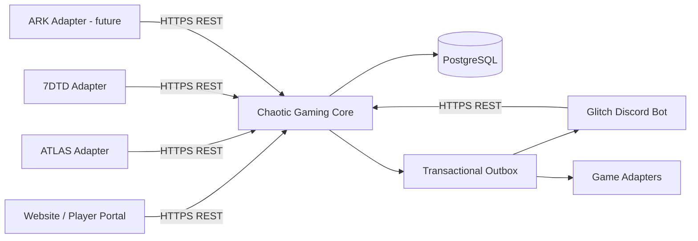

# System Overview

Core owns player identity, authorization, platform state, commerce entitlements and integration event records. Clients do not connect directly to PostgreSQL. The bot remains operational for independent Discord functions during Core outages.
